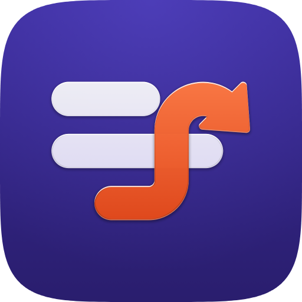
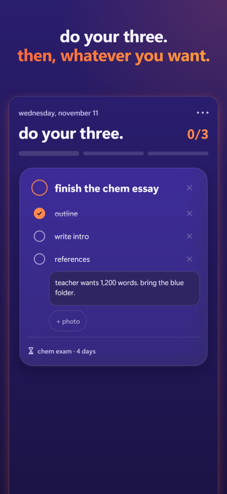
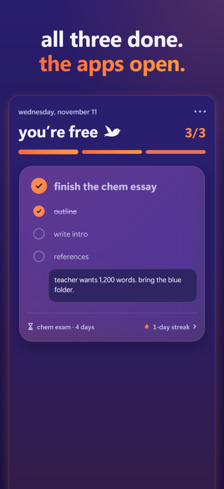
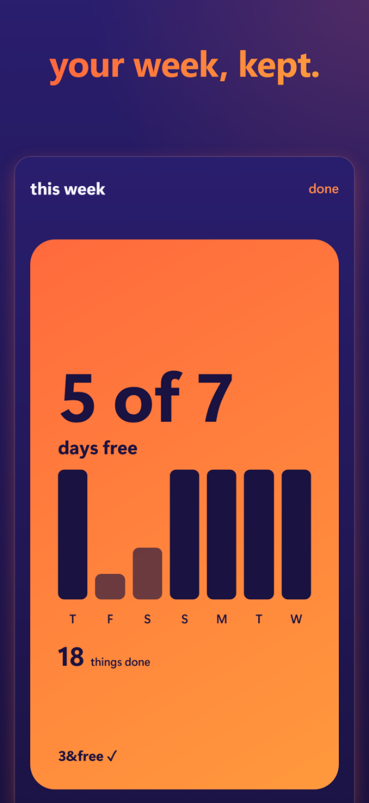

  

<h1 align="center">3&free</h1>

<b>Do your three. Then, whatever you want.</b>

An iPhone and iPad app: pick three things each day, and the apps that eat your time stay locked with Apple's Screen Time until all three are done.

  <a href="https://firstthings-studio.github.io/3andfree/">Support and FAQ</a> ·
  <a href="https://firstthings-studio.github.io/3andfree/privacy.html">Privacy policy</a> ·
  <a href="mailto:3andfree.app@gmail.com">Contact</a>

  
  
  

## What it does

- **Your three, on cards.** Steps, notes and photos for each, and a tick when it's done.
- **A real lock.** Choose apps with Apple's own picker; they stay locked until all three are ticked, then open for an hour. One 15-minute emergency unlock a day.
- **Lock Screen and Dynamic Island.** A Live Activity and widgets show what's left.
- **Countdowns.** Exams and deadlines in your own words, like "essay · 14 days".
- **Private by design.** No account, no ads, no tracking. Everything stays on your iPhone; nothing is uploaded.

## About this repository

This repository hosts the app's public support and privacy pages, served with GitHub Pages at
[firstthings-studio.github.io/3andfree](https://firstthings-studio.github.io/3andfree/). The app itself is distributed through the App Store.

Made by Rushal Sircar (First Things). Questions, bugs or ideas: [3andfree.app@gmail.com](mailto:3andfree.app@gmail.com).
